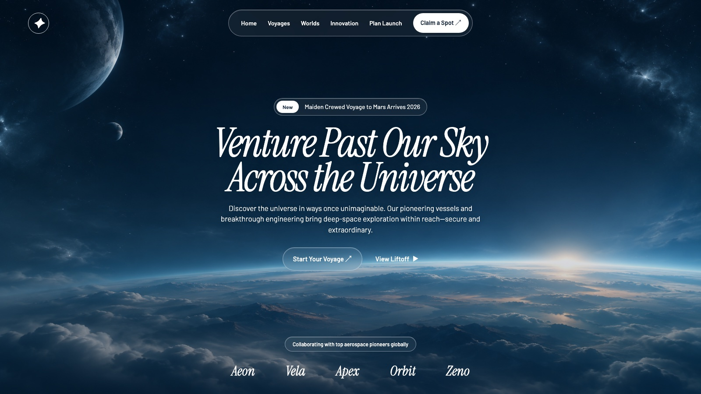
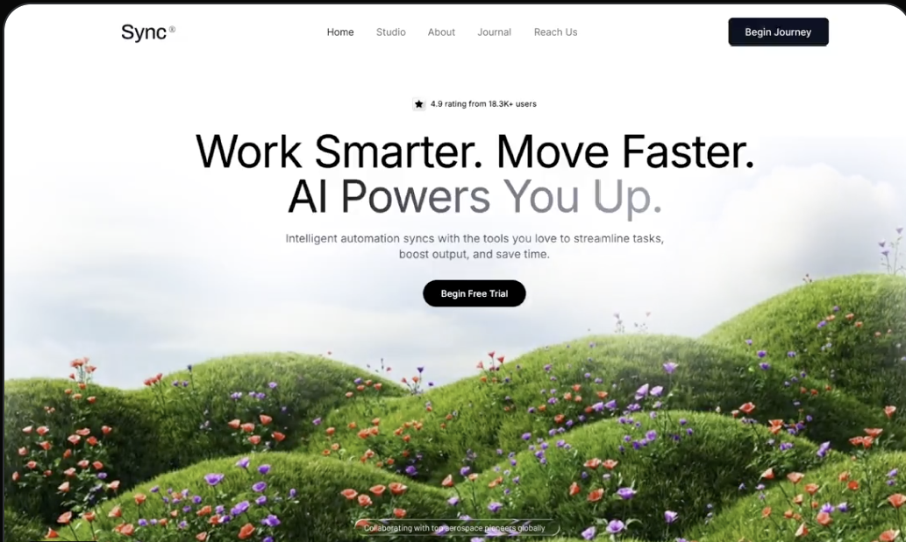
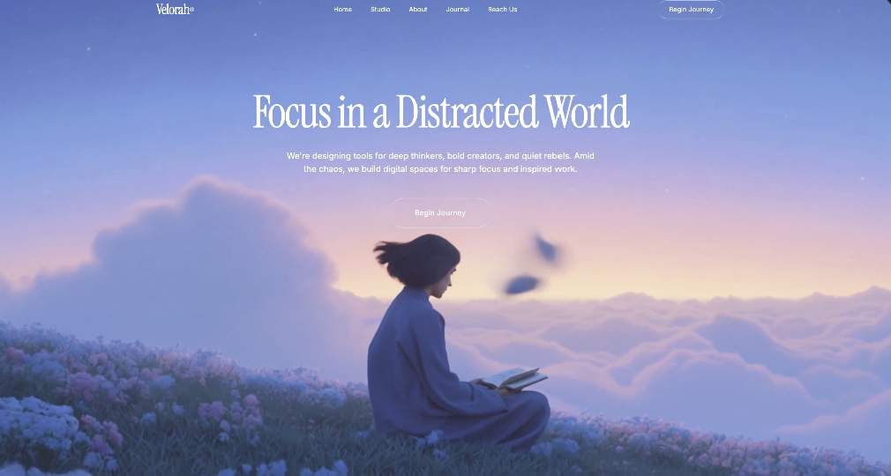
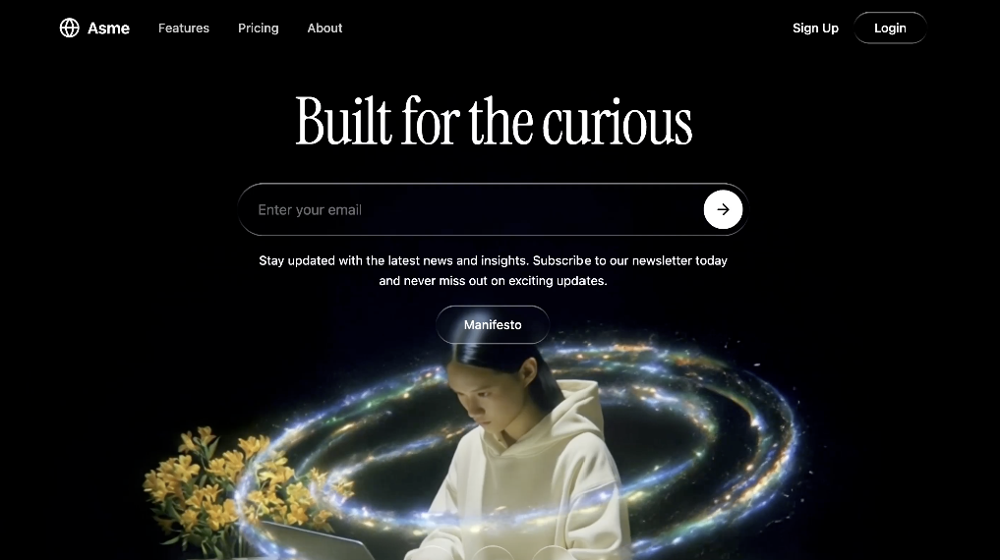
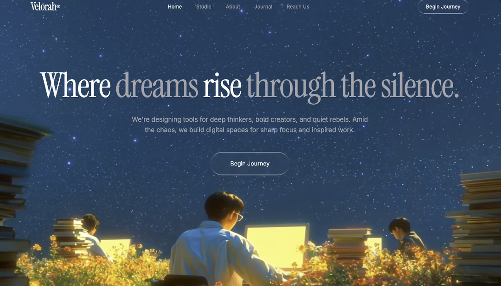

<h1 align="center">动态效果UIUX设计灵感库</h1>

  

每条设计都有原始提示词、中文说明、标签、预览图和面向新手的 DIY 教程。预览图用于展示设计方向；具体实现以原始提示词和实际素材为准。

| 预览 | 设计 | 标签 | 入门教程 |
| --- | --- | --- | --- |
|  | [001 · 电影感太空旅行首屏](designs/001-space-travel-hero/README.md) | 太空、背景视频、液态玻璃、文字动画 | [更换视频与调整风格](designs/001-space-travel-hero/DIY.md) |
|  | [002 · 绿丘花草](designs/002-sync-saas-hero/README.md) | SaaS、视频背景、白色渐隐、响应式 | [更换视频、品牌和文案](designs/002-sync-saas-hero/DIY.md) |
|  | [003 · 云端冥想](designs/003-velorah-electric-rv/README.md) | 六段式、视频叙事、液态玻璃、HLS | [替换四处视频并统一页面主题](designs/003-velorah-electric-rv/DIY.md) |
|  | [004 · 星环萦绕](designs/004-star-ring-orbit/README.md) | 暗色首屏、星环视频、液态玻璃、邮件订阅 | [更换视频与调整循环淡入淡出](designs/004-star-ring-orbit/DIY.md) |
|  | [005 · 星夜兼程](designs/005-night-journey/README.md) | 星空、视频背景、液态玻璃、衬线排版 | [更换星空视频与调整文字](designs/005-night-journey/DIY.md) |

## 收录方式

每个设计单独放在 `designs/编号-英文短名/` 中：

- `README.md`：中文概览、标签、素材状态与入口。
- `prompt.txt`：保留原始提示词。
- `preview.jpg` 或 `preview.png`：设计方向的静态预览。
- `DIY.md`：按步骤讲解如何替换素材与调整效果。

如果某条设计还附带可运行代码或其他素材，也放在该条目的目录中，并在说明里标出用途。

