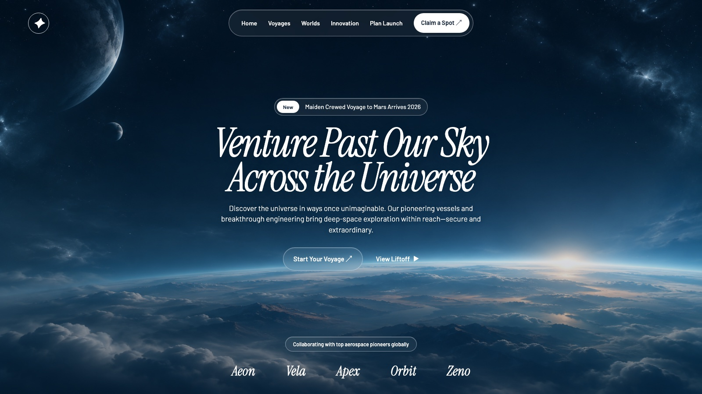

# 001 · 电影感太空旅行首屏

- **类型：** 网站首屏（Hero section）
- **风格：** 太空旅行、全屏视频、液态玻璃、柔和蓝色、逐词模糊进入动画
- **技术：** React、Vite、TypeScript、Tailwind CSS、motion/react、lucide-react
- **标签：** `网站首屏` `太空旅行` `背景视频` `液态玻璃` `文字动画`

> 这是一张根据原始提示词制作的静态概念预览，背景由 AI 生成。它展示构图与视觉方向，不是原视频的截图，也不是完整 React 实现。

## 设计概览

全屏太空视频作为背景，顶部是悬浮的玻璃质感导航栏，中间展示逐词出现的斜体大标题、说明文案和行动按钮，底部排列合作伙伴名称。

## 关键细节

- **背景：** 自动播放、循环、静音的视频；叠加轻微黑色遮罩。
- **字体与配色：** Instrument Serif 斜体标题、Barlow 正文；柔和天空蓝与白色。
- **组件：** 玻璃质感导航、消息徽标、主次按钮、合作伙伴栏。
- **动效：** 主标题逐词从下方模糊进入；副标题和按钮延迟出现。
- **响应式：** 桌面端显示完整导航；标题和合作伙伴字体随屏幕宽度调整。

## 素材状态

原始提示词包含一个外部视频地址，并引用 `/images/hero_bg.jpeg` 作为封面图；原始封面图和 Logo 文件尚未提供。目录中的 `preview-background.jpg` 是为概念预览生成的替代背景，`preview.html` 是用于制作预览图的静态页面，不包含原提示词要求的完整 React 动效。

## 原始内容

[查看完整英文提示词](prompt.txt)

## 新手 DIY

[按照教程更换视频、封面和文案](DIY.md)
