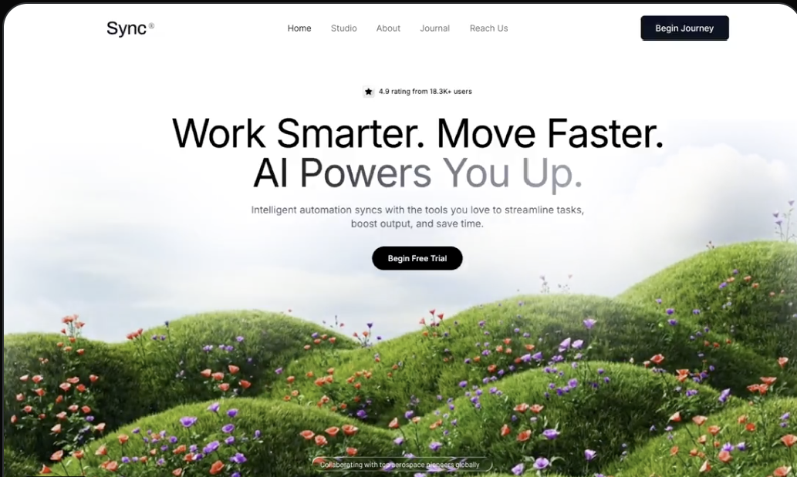

# 002 · 绿丘花草

- **类型：** SaaS 网站首屏（Hero section）
- **风格：** 白色留白、黑白灰界面、自然景观视频、渐隐过渡、轻量入场动画
- **技术：** React、TypeScript、Tailwind CSS、Lucide React、Inter 字体
- **标签：** `SaaS` `智能自动化` `视频背景` `白色渐隐` `响应式` `极简界面`

> 预览图由用户提供，展示的是 **Sync** 品牌版本。原始英文提示词写的是 **Stellar ai**，导航文字也有所不同；本条目同时保留封面和原文，方便学习如何把同一结构改成自己的品牌。

## 设计概览

页面占满一屏，顶部是简洁导航，中上部是评分、两行标题、说明和主按钮。背景视频主要显示在下半部，并通过白色渐变融入上方留白。底部有半透明标签和合作伙伴名称。界面本身以黑白灰为主，视频画面可以带来自然景观等其他色彩。

## 关键细节

- **视频层：** 全屏循环、静音、自动播放，通过顶部留白和白色渐变，让画面集中在下半部。
- **文字层：** Inter 字体；标题第二行由黑色渐变为灰色。
- **导航层：** 桌面端显示栏目和按钮，手机端切换为可展开菜单。
- **入场动画：** 导航、评分、标题、说明、按钮和底栏依次向上淡入。
- **底栏：** 玻璃质感的标签和五个文字形式的合作伙伴名称。

## 素材状态

`preview.png` 是本条目的封面图。原始提示词提供了一个外部视频地址，视频文件本身没有存入仓库。封面图是静态图片，不能代替可播放的视频；要做动态页面，需要按提示词提供视频素材并生成或编写网页。

## 原始提示词与 DIY

- [查看完整英文提示词](prompt.txt)
- [新手 DIY：更换视频、品牌和文案](DIY.md)
