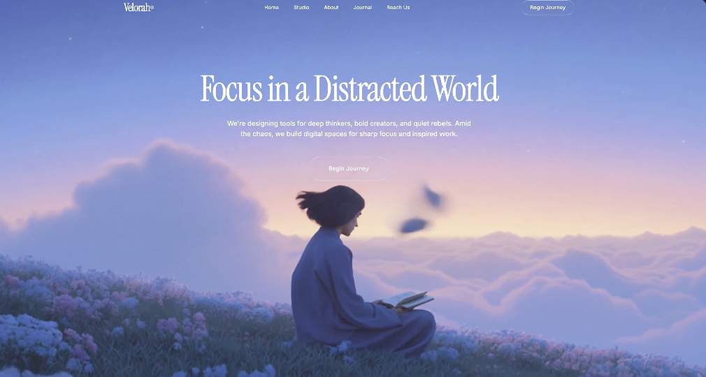

# 003 · 云端冥想

- **类型：** 品牌网站单页，包含六个纵向区块
- **风格：** 视频叙事、深色界面、衬线大标题、液态玻璃按钮
- **技术：** React、TypeScript、Tailwind CSS、hls.js、Inter、Instrument Serif
- **标签：** `品牌网站` `电动房车` `六段式页面` `视频背景` `HLS` `液态玻璃`

> 预览图由用户提供，只展示首屏。图中是柔和云海与「Focus in a Distracted World」；原始提示词则要求深色电动房车单页，首屏标题是「Where dreams rise through the silence.」。本库原样保留图片和提示词，方便对照与改造。

## 设计概览

原始提示词规划六个依次向下的区块：

1. **首屏：** 全屏视频、品牌导航、衬线大标题和玻璃质感按钮。
2. **品牌短句：** 居中展示「So you can feel at home, anywhere.」。
3. **功能分栏：** 左侧介绍纯电动体验及可切换标签，右侧播放视频。
4. **产品宣言：** 以 HLS 视频为背景，介绍配套 App 与四项能力。
5. **预约区：** 视频背景、起售价、预订与预约参观按钮。
6. **页脚：** 品牌口号、导航链接、订阅入口和政策链接。

## 使用前需统一的细节

- 图片里的专注力文案与提示词中的电动房车主题不同。选择一个主题后，再统一标题、正文、视频和按钮。
- 原文一处写 `Instrumental+Serif`，另一处写 `Instrument+Serif`；实现时应统一字体名称。
- 原文说页面背景为纯黑，同时把 `--background` 写成 `201 100% 13%`；实现时应确定实际使用的背景色。

这些差异仅作标注，[原始英文提示词](prompt.txt)未改写。

## 素材状态与 DIY

`preview.png` 是静态首屏图。原始提示词引用四处外部视频（其中一处为 `.m3u8` HLS 流），视频文件没有存入仓库；图片也不代表下面五个区块已经实现。

- [查看完整英文提示词](prompt.txt)
- [新手 DIY：替换视频、统一页面主题](DIY.md)
