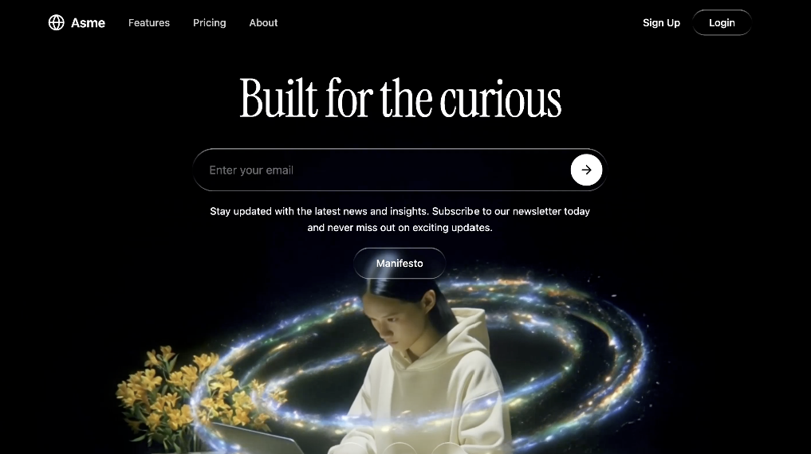

# 004 · 星环萦绕

- **类型：** 单屏品牌网站首屏（Hero section）
- **风格：** 黑色电影感背景、星环画面、液态玻璃、衬线标题
- **技术：** Vite、React 18、TypeScript、Tailwind CSS 3、Lucide React
- **标签：** `暗色首屏` `背景视频` `星环` `液态玻璃` `邮件订阅` `无缝循环`

> 预览图由用户提供。画面中的星环依赖背景视频素材；原始提示词只规定了视频播放与玻璃质感界面，没有单独绘制星环的代码。

## 设计概览

整页占满一屏。黑色背景视频提供主要画面，顶部是 Asme 导航与玻璃质感登录按钮；中间以 Instrument Serif 展示「Built for the curious」，下方是邮件输入、订阅说明和 Manifesto 按钮；底部排列三个社交图标。

## 关键细节

- **视频位置：** 全屏 `object-cover`，再向下移动 17%，让主要画面落在下半部。
- **循环淡入淡出：** 视频开始时用 JavaScript 在 500 毫秒内淡入；临近结尾时淡出，重播后再淡入。新动画会取消旧的动画帧，避免闪跳。
- **液态玻璃：** 透明背景、轻微模糊和伪元素高光边框，用于导航按钮、邮件输入框、Manifesto 按钮与社交图标。
- **响应式：** 桌面端显示导航链接；手机端隐藏这些链接，保留品牌与操作入口。

## 素材与功能状态

`preview.png` 是静态封面，原始提示词里的视频仍是外部链接，视频文件没有存入仓库。封面可以展示构图，但无法演示循环淡入淡出。原始提示词也没有指定邮件订阅的提交服务；要实际收集邮件，需要另行接入表单处理。

原文同时要求视频使用原生 `loop`，又要求在 `ended` 事件中手动重播。两种循环方式应选一种；如果实现手动淡出与重播，应移除原生 `loop`。具体见下方 DIY 教程。

- [查看完整英文提示词](prompt.txt)
- [新手 DIY：更换视频并调整效果](DIY.md)
