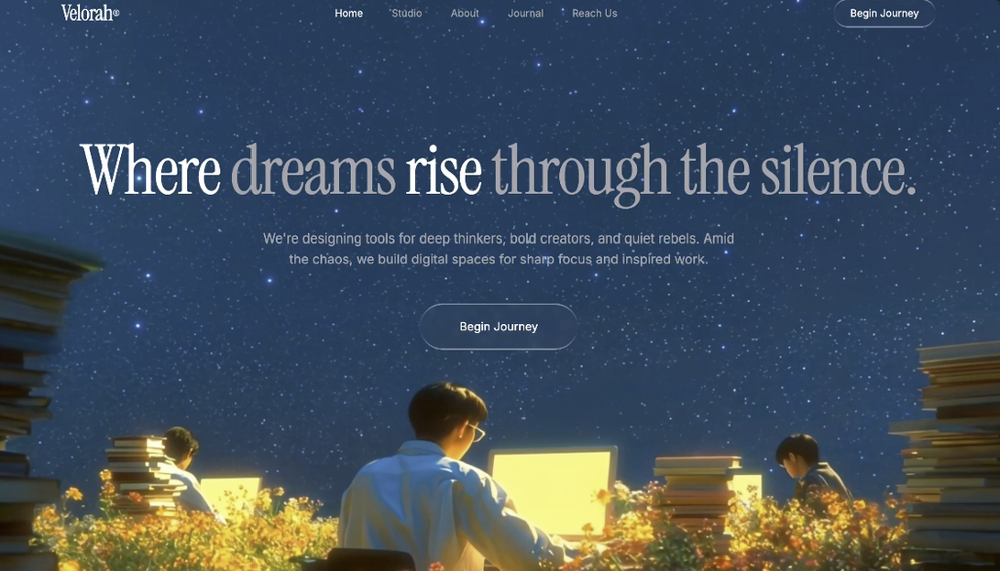

# 005 · 星夜兼程

- **类型：** 单屏品牌网站首屏（Hero section）
- **风格：** 深蓝星空、电影感视频、液态玻璃、衬线大标题
- **技术：** React、Vite、TypeScript、Tailwind CSS、shadcn/ui
- **标签：** `星空` `暗色首屏` `视频背景` `液态玻璃` `衬线排版` `淡入动画`

> 预览图由用户提供，展示星空下的人物、花草与工作场景。它是静态图片；原始提示词中的全屏视频仍需单独提供。

## 设计概览

Velorah 的品牌导航位于顶部；全屏视频负责星夜画面和纵深感。中央是「Where dreams rise through the silence.」的衬线大标题、简短说明和玻璃质感的「Begin Journey」按钮。标题、正文和按钮依次向上淡入。

## 关键细节

- **视频：** 铺满视口、静音自动播放、循环，使用 `object-cover` 裁切。
- **颜色：** 深海军蓝背景、白色主文字、灰色强调文字。
- **排版：** 大标题使用衬线字体；`dreams` 和 `through the silence.` 使用柔和灰色形成层次。
- **玻璃质感：** 导航和按钮使用透明背景、轻微模糊、内阴影与伪元素边框。
- **动画：** 标题先出现，正文延迟 0.2 秒，按钮再延迟 0.4 秒。

## 素材与实现提示

`preview.png` 是本条目的封面。原始提示词引用外部 MP4，视频文件没有存入仓库。原文中字体名称同时出现 `Instrumental Serif` 和 `Instrument Serif` 两种写法；实现时应统一导入与使用的名称。首屏的上下内边距类也有重叠写法，可在落地时选择明确的一组。

- [查看完整英文提示词](prompt.txt)
- [新手 DIY：更换视频与调整文字](DIY.md)
