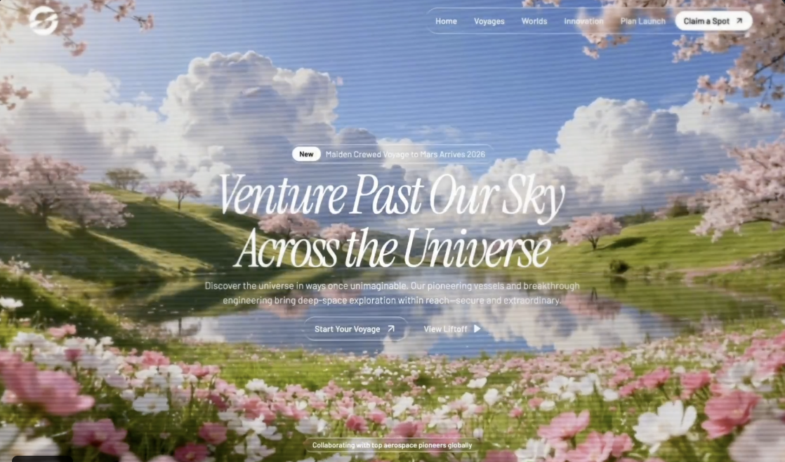

# 006 · 神湖花海

- **类型：** 单屏网站首屏（Hero section）
- **风格：** 花海湖泊、电影感视频、液态玻璃、斜体衬线大标题
- **技术：** React、Vite、TypeScript、Tailwind CSS、motion/react、Lucide React
- **标签：** `花海` `湖泊` `背景视频` `液态玻璃` `文字模糊入场` `品牌首屏`

> 预览图由用户提供，展示花海、湖泊与天空中的品牌首屏。它是一张静态图片；水面、花草和天空的动态效果取决于实际使用的视频。

## 设计概览

画面以铺满屏幕的视频为背景，顶部是品牌标志和胶囊形导航。中央依次出现新消息标签、斜体大标题、简短说明与两个行动按钮；底部有合作伙伴说明和品牌名称。原始提示词保留了太空旅行网站的文案，预览图则展示花海湖泊场景。这两部分可以一起替换，做成自己的主题。

## 关键细节

- **背景：** 全屏静音循环视频，使用 `object-cover` 裁切，并叠加很淡的黑色遮罩，让白色文字更清楚。
- **字体：** Instrument Serif 斜体用于主标题和合作伙伴名称，Barlow 用于导航与正文。
- **入场动画：** 标题按单词从下方模糊进入；说明和按钮稍后依次出现。
- **液态玻璃：** 导航、消息标签和按钮使用透明背景、背景模糊、内阴影与高光边框。
- **布局：** 顶部固定导航，中部居中内容，底部放合作伙伴区域。

## 素材与实现提示

`preview.png` 是静态封面。原始提示词引用外部 MP4，视频文件没有存入仓库；它还要求 `/images/hero_bg.jpeg` 作为视频加载前的封面，但该图片未随提示词提供。左上角品牌标志也需要自行准备。如果希望生成的页面接近这张预览图，应提供花海湖泊的视频和同场景封面，并按 DIY 教程调整文案。

- [查看完整英文提示词](prompt.txt)
- [新手 DIY：更换视频、封面和主题](DIY.md)
