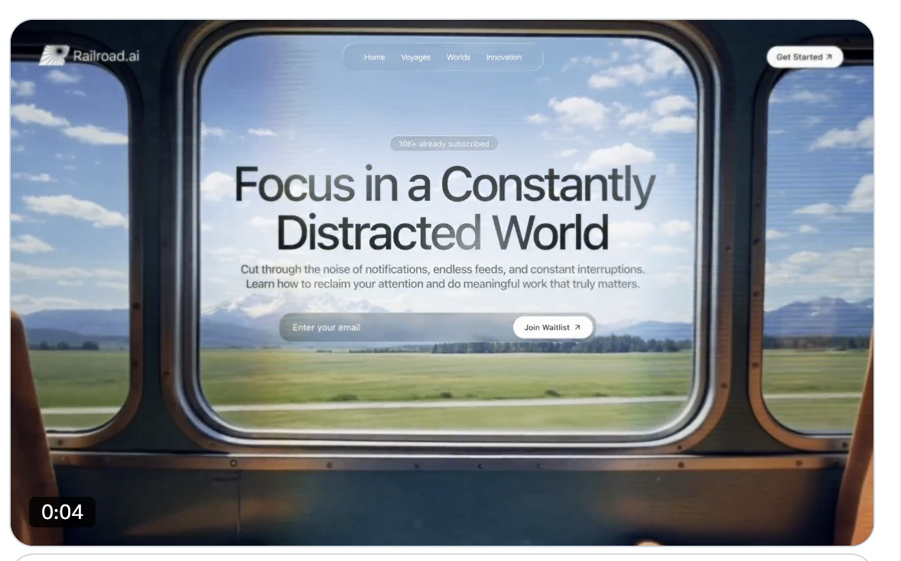

# 007 · 旅行窗外

- **类型：** 单屏品牌网站首屏（Hero section）
- **风格：** 列车窗景、明亮天空、电影感视频、液态玻璃
- **技术：** React、Vite、TypeScript、Tailwind CSS、framer-motion、Lucide React、shadcn/ui 设计变量
- **标签：** `列车窗景` `背景视频` `液态玻璃` `逐词入场` `邮件候补名单` `响应式`

> 预览图由用户提供，是列车窗景首屏的静态画面。窗框和窗外景色来自画面素材；原始提示词没有另外绘制列车窗框的代码。

## 设计概览

全屏视频展示透过列车窗户看到的天空与草地。顶部放品牌、玻璃质感导航和「Get Started」按钮；中央是订阅人数标签、深色标题、说明文字，以及带「Join Waitlist」按钮的邮件输入框。标题逐词模糊进入，说明和输入框随后出现。

## 关键细节

- **视频：** `object-cover` 铺满视口，静音自动播放、循环，并覆盖一层很淡的黑色遮罩。
- **排版：** 标题和正文实际使用系统字体；提示词虽然要求导入 Instrument Serif 与 Barlow，但没有把它们应用到页面文字。
- **颜色：** 白色导航与按钮、近黑色标题、灰色说明，依赖窗外明亮景色形成对比。
- **玻璃质感：** 导航、人数标签和邮件输入框使用半透明背景、模糊与高光边框。
- **动效：** 标题逐词模糊上移；正文和邮件输入框按延迟依次淡入。

## 素材与功能状态

`preview.png` 是静态封面。提示词引用外部 MP4，视频文件未存入仓库。若想换成飞机、轮船或其他「窗外」效果，新视频需要包含对应窗景，或者另行制作窗框图层。提示词只描述邮件输入框的外观；若要真正收集邮箱，还需接入提交服务。

原始提示词将品牌文字写作 `http://Railroad.ai`，而预览图只显示 `Railroad.ai`。制作自己的版本时，可按品牌需求确定最终展示文字。

- [查看完整英文提示词](prompt.txt)
- [新手 DIY：替换窗景视频和订阅内容](DIY.md)
